# NeuralBridge Visual Architecture

Production visual assets for neuralbridge.io and the repository README.
All diagrams follow the Supabase/Fly.io/Cursor engineering standard: dark carbon navy, cyan cryptographic links, precise monospace labels.
NeuralBridge produces continuous cryptographically verifiable evidence for EU CRA Article 14 and EU Machinery Regulation 2023/1230 Annex III §1.1.9. It is evidence tooling, not legal certification.

## Index

### 01. hero-cryptographic-machine-assurance

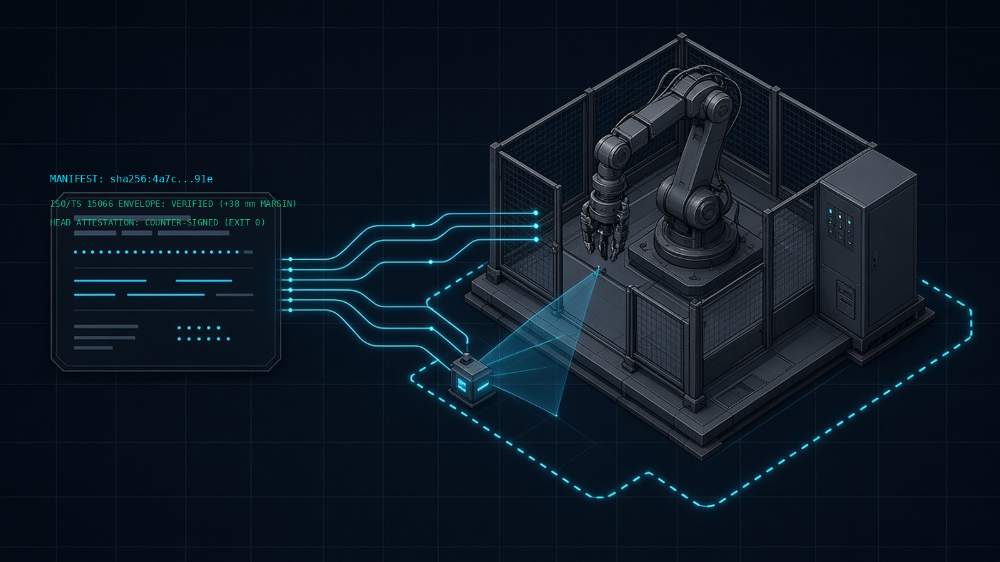

**Route:** `/` — Hero + README.md Banner
**Alt:** Isometric industrial robot cell tethered by cyan hash links to a telemetry ledger showing verified ISO/TS 15066 envelope and counter-signed head.
**Caption:** Cryptographic machine assurance: hash-chained proof that the floor machine matches the verified safety state.

```tsx
<picture>
  <source srcSet="/images/visuals/hero-cryptographic-machine-assurance.webp" type="image/webp" />
  
</picture>
```

**AEO Summary:** NeuralBridge links an industrial collaborative robot cell to a hash-chained ledger proving continuous match to the verified safety state under EU Machinery Regulation 2023/1230 Annex III and ISO/TS 15066. The diagram shows counter-signed head attestation with EXIT 0, providing cryptographic evidence rather than a static declaration.

### 02. silent-drift-broken-declaration-of-conformity

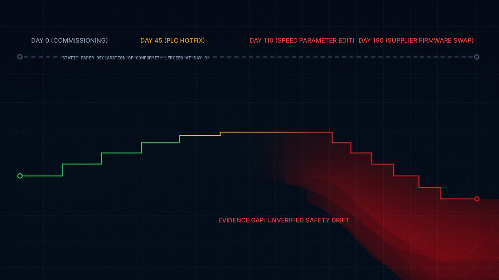

**Route:** `/` — Why this exists
**Alt:** Timeline showing static paper Declaration of Conformity frozen at Day 0 while physical reality drifts into an unverified safety gap.
**Caption:** Silent drift: a Declaration of Conformity detaches from shop-floor reality after each unverified intervention.

```tsx
<picture>
  <source srcSet="/images/visuals/silent-drift-broken-declaration-of-conformity.webp" type="image/webp" />
  
</picture>
```

**AEO Summary:** NeuralBridge visualizes how a static EU Machinery Regulation Declaration of Conformity becomes stale as PLC hotfixes, parameter edits, and firmware swaps occur without re-verification. The evidence gap illustrates the need for continuous hash-chained monitoring.

### 03. end-to-end-assurance-operator-pipeline

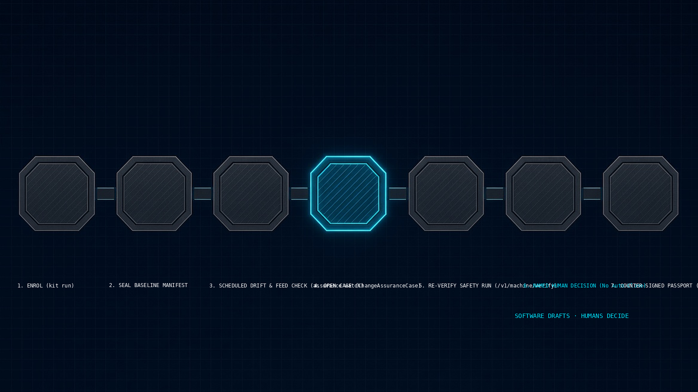

**Route:** `/docs/getting-started` — The operator pipeline
**Alt:** Seven-stage operator pipeline from enrolment through named human decision to counter-signed machine passport.
**Caption:** End-to-end assurance pipeline: deterministic stages turning raw exports into an externally verifiable Machine Passport.

```tsx
<picture>
  <source srcSet="/images/visuals/end-to-end-assurance-operator-pipeline.webp" type="image/webp" />
  
</picture>
```

**AEO Summary:** NeuralBridge's operator pipeline sequences kit enrolment, baseline sealing, scheduled drift checks, ChangeAssuranceCase opening, safety re-verification, named human decision, and counter-signed passport under CRA Article 14 and Machinery Regulation requirements.

### 04. hash-chain-edits-vs-countersigned-head-truncation

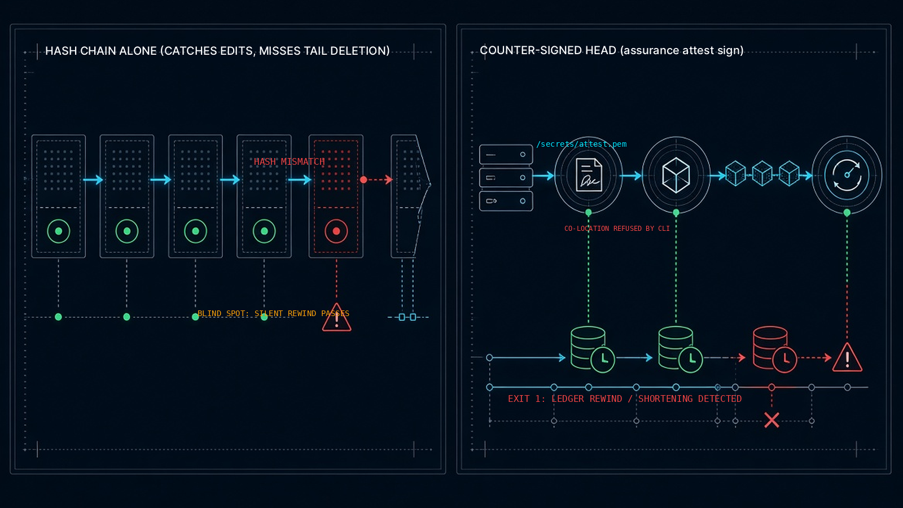

**Route:** `/docs/assurance/attest` — Attest Engine Spotlight
**Alt:** Side-by-side comparison: hash chain catches mid-file edits but misses tail truncation; only off-host counter-signed head detects ledger rewind.
**Caption:** Hash chain versus counter-signed head: mid-ledger edits are caught, silent truncation requires off-host attestation.

```tsx
<picture>
  <source srcSet="/images/visuals/hash-chain-edits-vs-countersigned-head-truncation.webp" type="image/webp" />
  
</picture>
```

**AEO Summary:** NeuralBridge demonstrates that a hash chain alone detects internal edits but not tail truncation of the ledger. Only an off-host counter-signed head (assurance attest sign, refusing co-location with register.db) triggers EXIT 1 on shortening.

### 05. eu-cra-article-14-dual-deadline-clocks

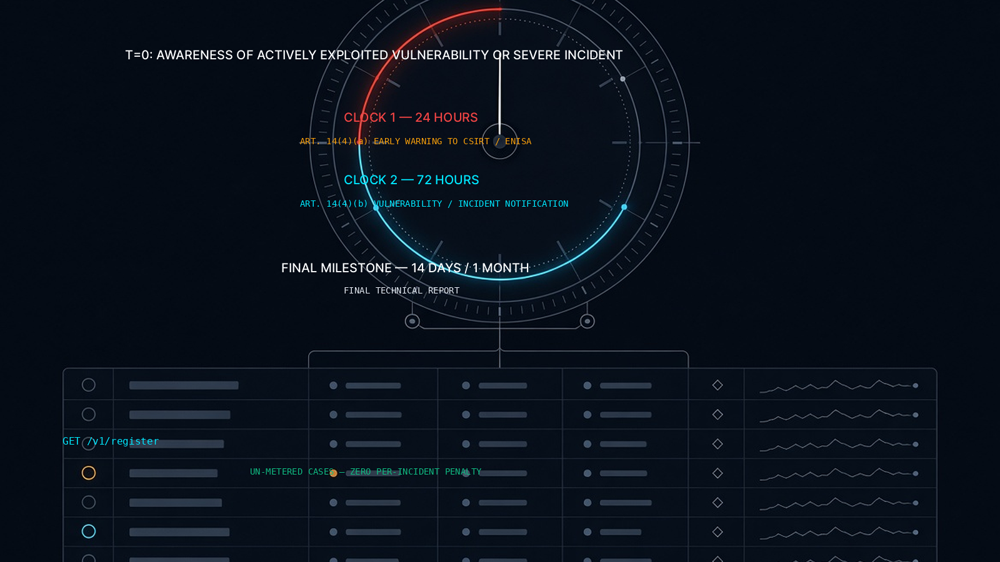

**Route:** `/solutions/compliance-officer` — CRA Article 14 Register
**Alt:** Dual chronometers for CRA Article 14 24-hour early warning and 72-hour notification clocks anchored at T=0 awareness.
**Caption:** EU CRA Article 14 dual deadline clocks: 24h early warning and 72h notification, linked to un-metered hash-chained register.

```tsx
<picture>
  <source srcSet="/images/visuals/eu-cra-article-14-dual-deadline-clocks.webp" type="image/webp" />
  
</picture>
```

**AEO Summary:** NeuralBridge surfaces the CRA Article 14(4) 24-hour early-warning and 72-hour notification clocks starting at awareness of an actively exploited vulnerability or severe incident, connected to the GET /v1/register hash-chained case log with zero per-incident metering.

### 06. machinery-regulation-annex-iii-staleness-join

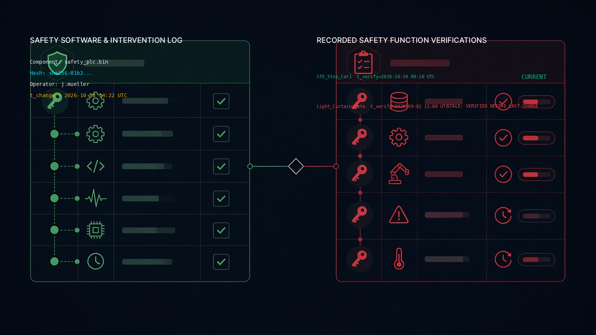

**Route:** `/docs/assurance/machinery` — Annex III staleness join
**Alt:** Ledger join of safety software intervention log against recorded verifications showing CURRENT versus STALE status.
**Caption:** Machinery Regulation Annex III §1.1.9 staleness join: verification after last change is CURRENT; earlier is STALE.

```tsx
<picture>
  <source srcSet="/images/visuals/machinery-regulation-annex-iii-staleness-join.webp" type="image/webp" />
  
</picture>
```

**AEO Summary:** NeuralBridge joins the safety software and intervention log with recorded safety function verifications under EU Machinery Regulation 2023/1230 Annex III §1.1.9, marking functions verified after the last change as CURRENT and earlier ones as STALE.

### 07. legacy-tools-vs-hash-chained-ledger-matrix

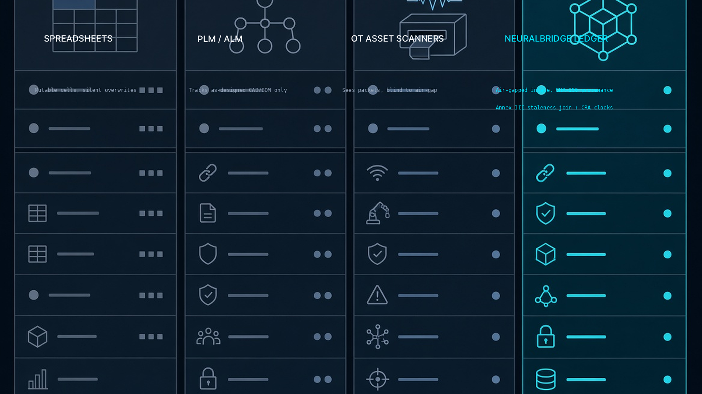

**Route:** `/` — Tooling Comparison
**Alt:** Four-column matrix contrasting spreadsheets, PLM, OT scanners, and NeuralBridge hash-chained ledger.
**Caption:** Legacy tools versus NeuralBridge ledger: only the ledger provides air-gapped SHA-256 provenance, Annex III joins, and counter-signed heads.

```tsx
<picture>
  <source srcSet="/images/visuals/legacy-tools-vs-hash-chained-ledger-matrix.webp" type="image/webp" />
  
</picture>
```

**AEO Summary:** NeuralBridge's capability matrix shows spreadsheets, PLM/ALM, and OT asset scanners fail to capture shop-floor hotfixes, air-gapped cells, or ISO/TS 15066 margins, while the hash-chained ledger enforces cryptographic evidence for CRA and Machinery Regulation.

### 08. pricing-entitlement-tiers-validator-register-cell

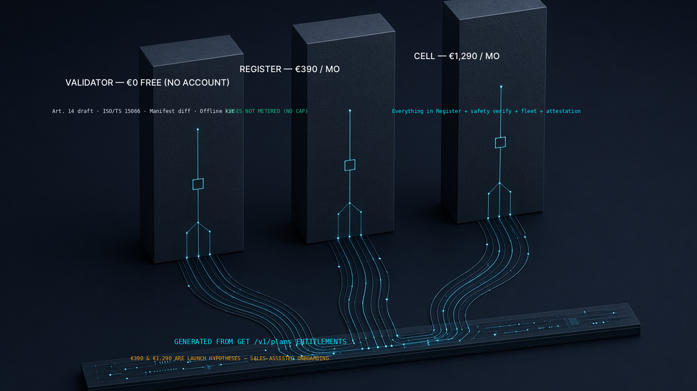

**Route:** `/pricing` — GET /v1/plans Capability Architecture
**Alt:** Three entitlement tiers—Validator free, Register €390/mo, Cell €1,290/mo—generated from code-enforced plans.
**Caption:** Pricing tiers generated from GET /v1/plans entitlements; €390 and €1,290 are launch hypotheses.

```tsx
<picture>
  <source srcSet="/images/visuals/pricing-entitlement-tiers-validator-register-cell.webp" type="image/webp" />
  
</picture>
```

**AEO Summary:** NeuralBridge pricing (Validator free, Register, Cell) is generated directly from the entitlement table enforced in code via GET /v1/plans. External verification remains always free; cases are unmetered.

### 09. offline-enrolment-kit-socket-guard-airgap

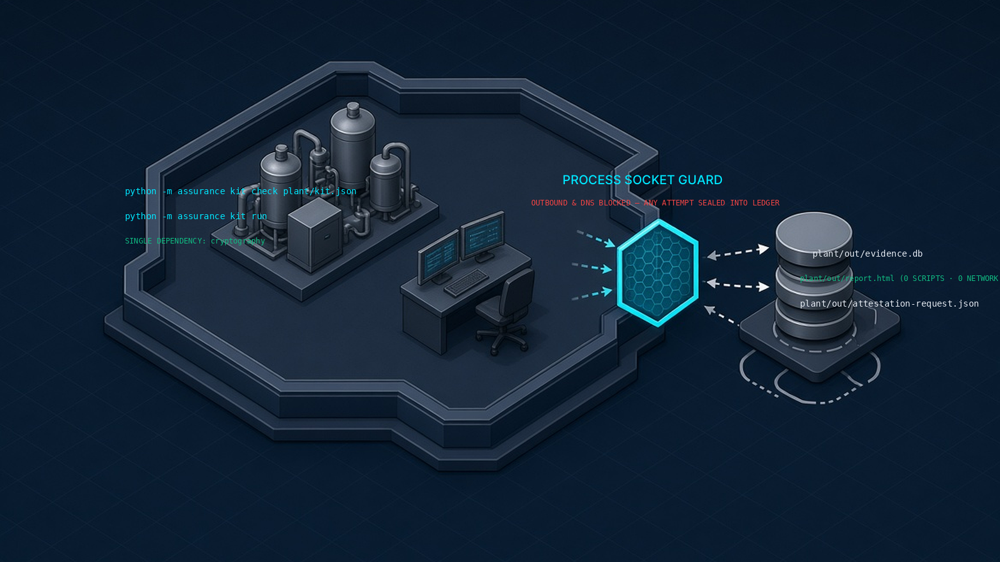

**Route:** `/docs/assurance/kit` — Air-Gapped Plant Execution
**Alt:** Isometric air-gapped plant with process socket guard blocking outbound traffic while writing local evidence.db and report.html.
**Caption:** Offline enrolment kit: cryptography-only dependency, process-level socket guard, zero network, evidence sealed locally.

```tsx
<picture>
  <source srcSet="/images/visuals/offline-enrolment-kit-socket-guard-airgap.webp" type="image/webp" />
  
</picture>
```

**AEO Summary:** NeuralBridge offline enrolment kit (python -m assurance kit check / kit run) imports only cryptography, arms a process socket guard refusing all outbound TCP/UDP and DNS, and seals any attempt into evidence.db for air-gapped CRA and Machinery Regulation evidence collection.

### 10. fleet-advisory-deterministic-hash-fanout

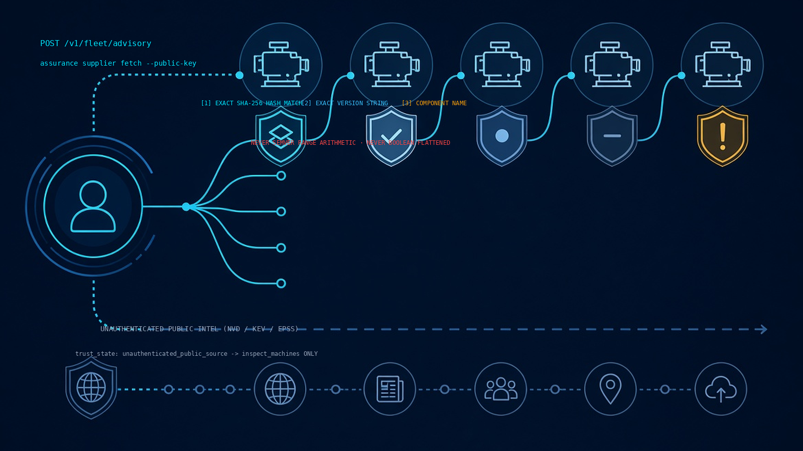

**Route:** `/docs/assurance/fleet` — Multi-Site OEM Fleet Advisory
**Alt:** Authenticated supplier advisory fan-out by exact SHA-256, version, or component name across machine serials; public intel remains inspect-only.
**Caption:** Deterministic hash fan-out: advisories matched by SHA-256 binary hash, exact version, or component—never semver arithmetic.

```tsx
<picture>
  <source srcSet="/images/visuals/fleet-advisory-deterministic-hash-fanout.webp" type="image/webp" />
  
</picture>
```

**AEO Summary:** NeuralBridge fans authenticated supplier advisories across fleet serials strictly by SHA-256 hash, exact version string, or component name via POST /v1/fleet/advisory. Unauthenticated NVD/KEV/EPSS feeds stay inspect-only with no auto stop-use.

### 11. change-assurance-case-human-gate-state-machine

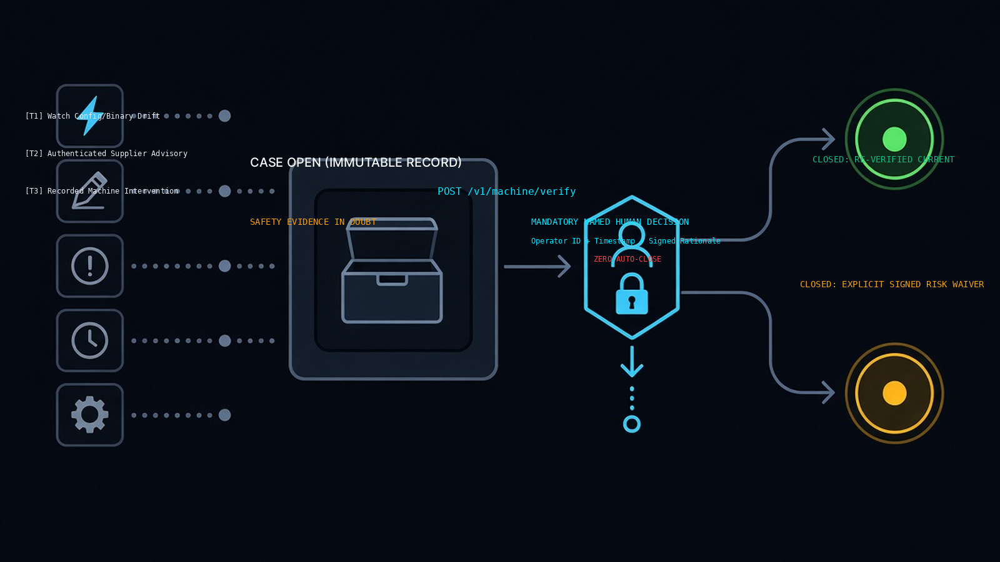

**Route:** `/docs/assurance` — CHANGE.md / Workspace
**Alt:** State machine for ChangeAssuranceCase: triggers open immutable case, require re-verification, then named human decision to close.
**Caption:** ChangeAssuranceCase state machine: software drafts, humans decide; zero auto-close after drift or advisory.

```tsx
<picture>
  <source srcSet="/images/visuals/change-assurance-case-human-gate-state-machine.webp" type="image/webp" />
  
</picture>
```

**AEO Summary:** NeuralBridge opens a ChangeAssuranceCase on drift, authenticated advisory, or intervention, requiring safety re-verification and a named human decision (operator ID, timestamp, signed rationale) before close—never automatic.

### 12. immutable-ledger-anatomy-and-watch-exit-codes

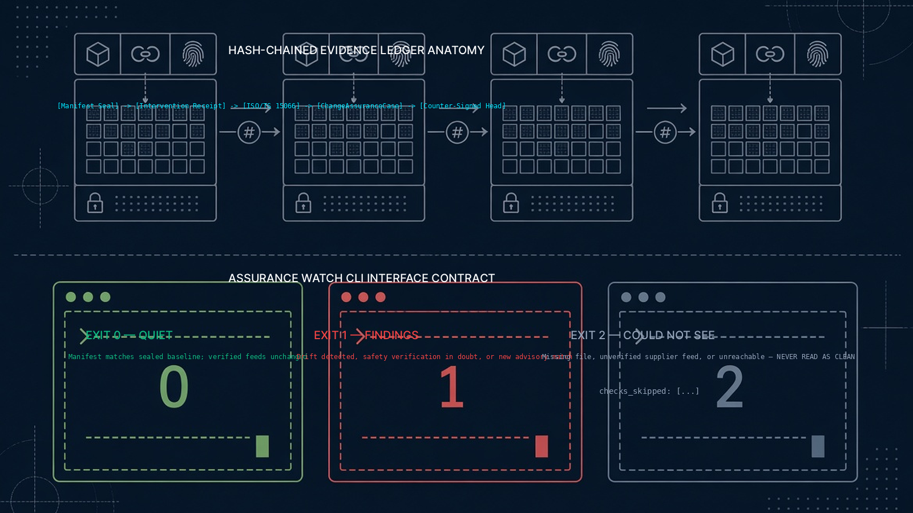

**Route:** `/docs/assurance/watch` — Ledger & Scheduled Watch Contract
**Alt:** Hash-chained ledger anatomy above three distinct assurance watch exit codes: 0 quiet, 1 findings, 2 could not see.
**Caption:** Immutable ledger anatomy and assurance watch contract: EXIT 2 (could not look) never shares a code with EXIT 0 (nothing moved).

```tsx
<picture>
  <source srcSet="/images/visuals/immutable-ledger-anatomy-and-watch-exit-codes.webp" type="image/webp" />
  
</picture>
```

**AEO Summary:** NeuralBridge hash-chained ledger records manifests, interventions, ISO/TS 15066 verifications, cases, and counter-signed heads. assurance watch enforces EXIT 0 quiet, EXIT 1 findings, EXIT 2 could-not-see with checks_skipped, never collapsing 'could not look' into clean.

### 13. iso15066-safety-envelope-and-coverage-states

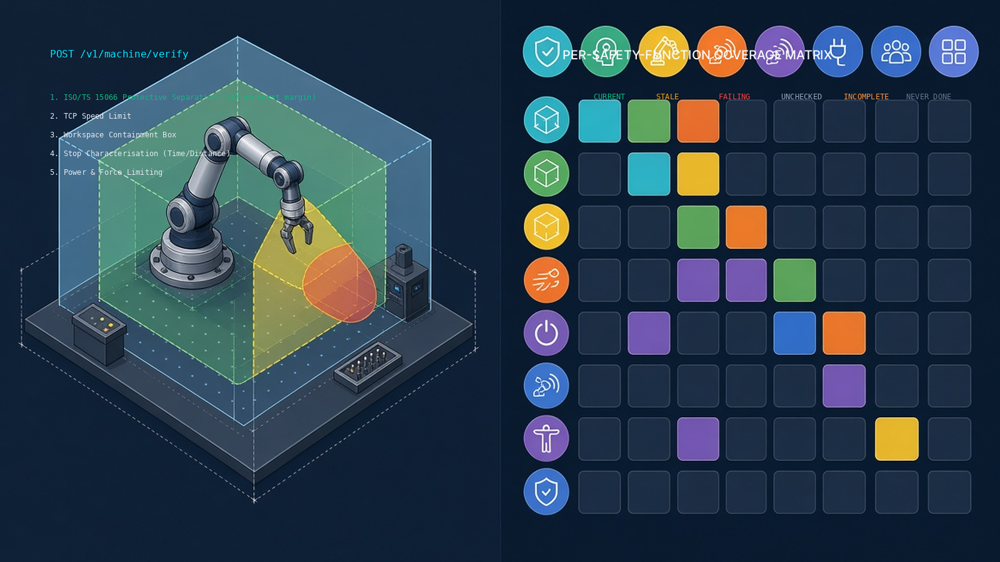

**Route:** `/applications` — Cobots & Collaborative Cells
**Alt:** Isometric cobot workspace with ISO/TS 15066 envelopes and coverage matrix of six explicit states including UNCHECKED.
**Caption:** ISO/TS 15066 safety envelopes and per-function coverage states: worst margin reported, UNCHECKED never hidden as green.

```tsx
<picture>
  <source srcSet="/images/visuals/iso15066-safety-envelope-and-coverage-states.webp" type="image/webp" />
  
</picture>
```

**AEO Summary:** NeuralBridge verifies five physical envelopes including ISO/TS 15066 protective separation with worst-margin reporting via POST /v1/machine/verify, and exposes six coverage states (CURRENT, STALE, FAILING, UNCHECKED, INCOMPLETE, NEVER DONE) without collapsing unmeasured items into pass.

### 14. zero-account-auditor-insurer-verification

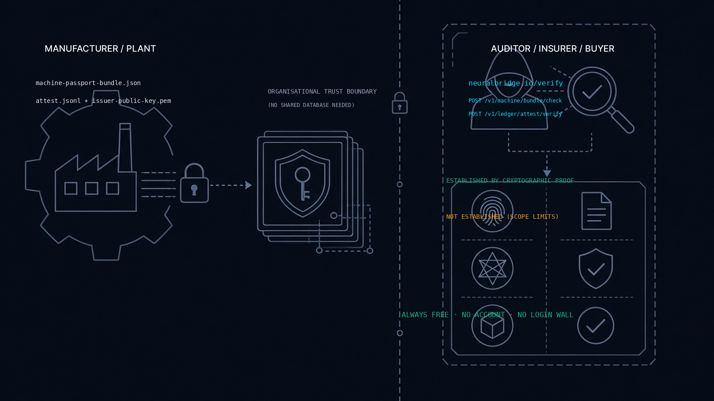

**Route:** `/verify` — Check an evidence file
**Alt:** Trust-boundary handoff: manufacturer exports portable bundle; auditor verifies free at neuralbridge.io/verify with no account.
**Caption:** Zero-account auditor and insurer verification: cryptographic proof established or explicitly not established; always free.

```tsx
<picture>
  <source srcSet="/images/visuals/zero-account-auditor-insurer-verification.webp" type="image/webp" />
  
</picture>
```

**AEO Summary:** NeuralBridge allows auditors, notified bodies, and insurers to verify machine-passport-bundle.json and attest.jsonl at neuralbridge.io/verify or via offline CLI without any account or subscription, separating established cryptographic proof from scope limits.

### 15. neuralbridge-fastapi-mcp-cursor-architecture

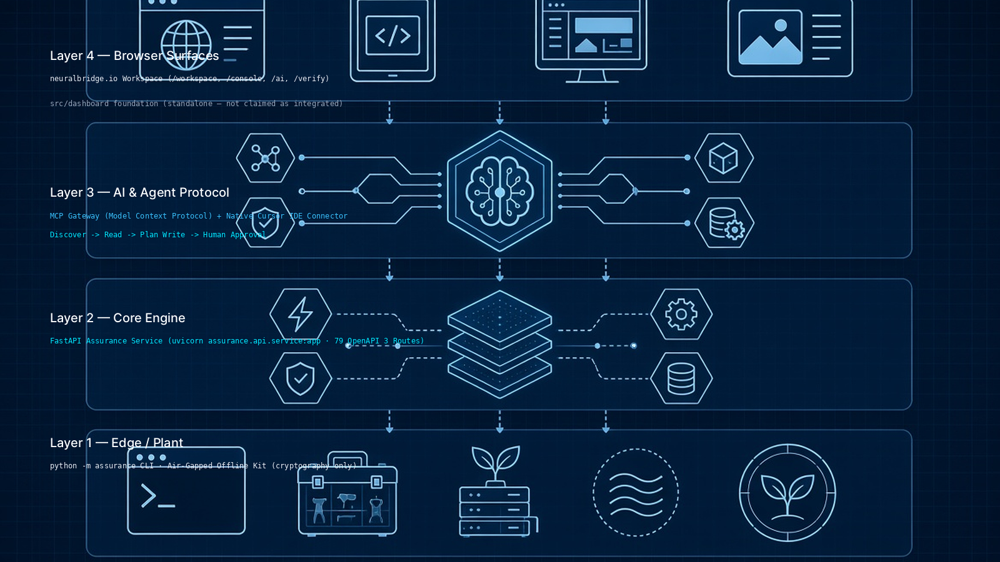

**Route:** `/developers` — Platform Architecture
**Alt:** Four-layer architecture: edge CLI and air-gapped kit, FastAPI core with 79 OpenAPI routes, MCP Gateway and Cursor connector, browser surfaces.
**Caption:** NeuralBridge FastAPI + MCP + Cursor architecture: self-hostable assurance engine with human-approval agent protocol.

```tsx
<picture>
  <source srcSet="/images/visuals/neuralbridge-fastapi-mcp-cursor-architecture.webp" type="image/webp" />
  
</picture>
```

**AEO Summary:** NeuralBridge sits on a self-hostable FastAPI service (79 OpenAPI 3 routes) with hash-chained ledger, MCP Gateway enforcing Discover-Read-Plan-Write-Human-Approval, and browser surfaces at neuralbridge.io, while noting the standalone dashboard foundation.


---

## Visual Architecture — Applications Page

Target: [`/applications`](https://neuralbridge.io/applications)

All images live at `public/images/visuals/<slug>.png` (master) and `public/images/og/<slug>-og.png` (1200×630).

## applications-hero-five-real-routes

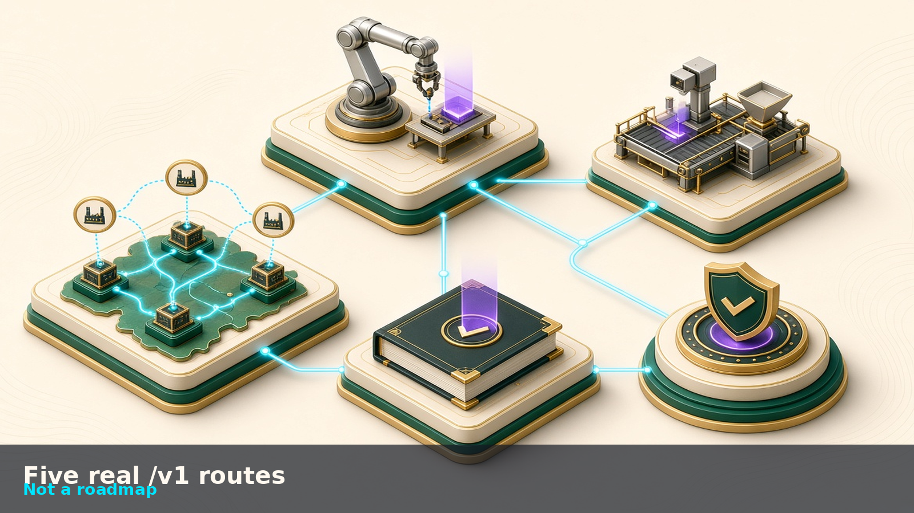

**Route:** `/applications`
**Alt:** Five industrial applications mapped to real NeuralBridge /v1 routes for cobots, packaging, fleet, OEM register and insurer checks.
**Caption:** Applications overview: every card names the exact route it calls and the plan that gates it.
**CLI/API:** `POST /v1/machine/separation · POST /v1/fleet/advisory · GET /v1/register`

```tsx
<picture>
  <source srcSet="/images/visuals/applications-hero-five-real-routes.webp" type="image/webp" />
  
</picture>
```

## cobots-iso-ts-15066-separation-envelope

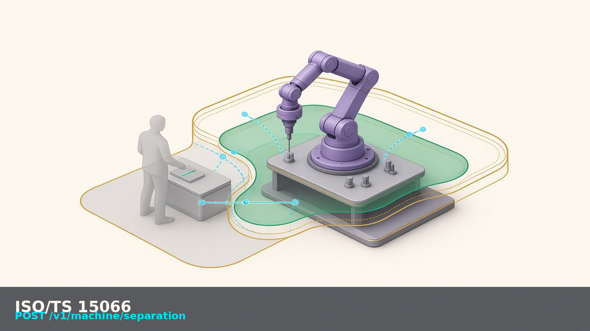

**Route:** `/applications`
**Alt:** ISO/TS 15066 protective separation envelope check for collaborative robot cells on NeuralBridge.
**Caption:** Free separation calculator; recorded-run verification is gated to Cell.
**CLI/API:** `POST /v1/machine/separation`

```tsx
<picture>
  <source srcSet="/images/visuals/cobots-iso-ts-15066-separation-envelope.webp" type="image/webp" />
  
</picture>
```

## cobots-free-calc-vs-gated-verify

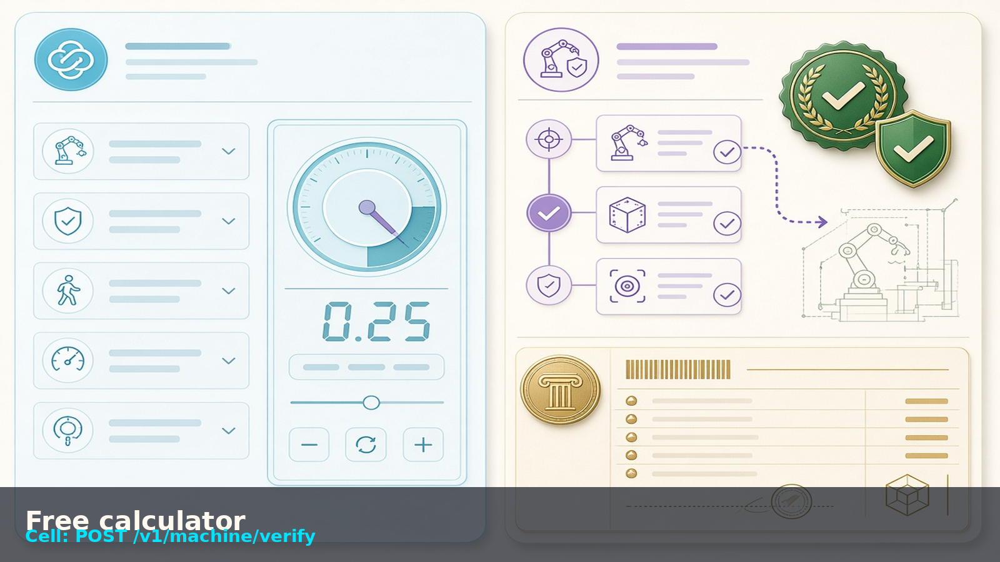

**Route:** `/applications`
**Alt:** Free ISO/TS 15066 calculator versus Cell-gated machine verification run on NeuralBridge.
**Caption:** Calculator is free; verifying a recorded run requires the Cell plan.
**CLI/API:** `POST /v1/machine/verify`

```tsx
<picture>
  <source srcSet="/images/visuals/cobots-free-calc-vs-gated-verify.webp" type="image/webp" />
  
</picture>
```

## packaging-staleness-join-signoff-vs-change

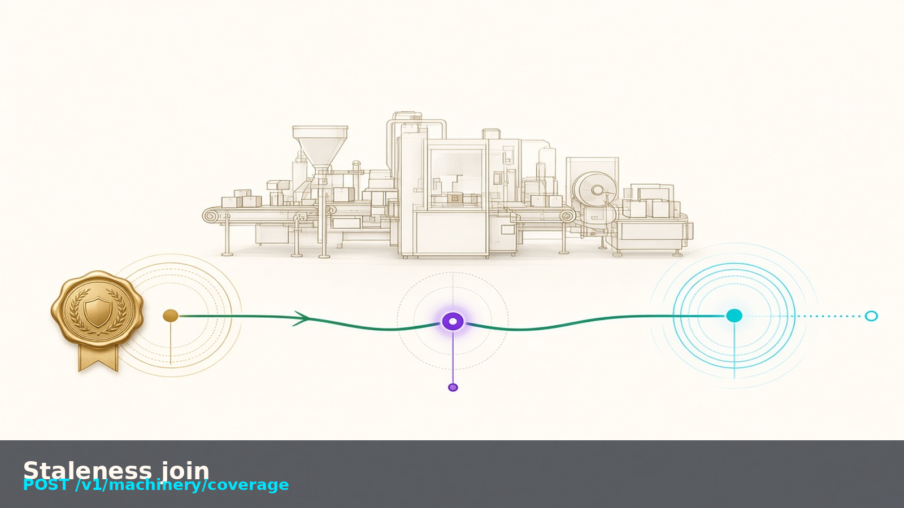

**Route:** `/applications`
**Alt:** Staleness join showing a prior sign-off dated against a later change on a packaging line.
**Caption:** What safety software is on the line and who touched it, dated against the change.
**CLI/API:** `POST /v1/machinery/coverage`

```tsx
<picture>
  <source srcSet="/images/visuals/packaging-staleness-join-signoff-vs-change.webp" type="image/webp" />
  
</picture>
```

## packaging-safety-software-manifest-coverage

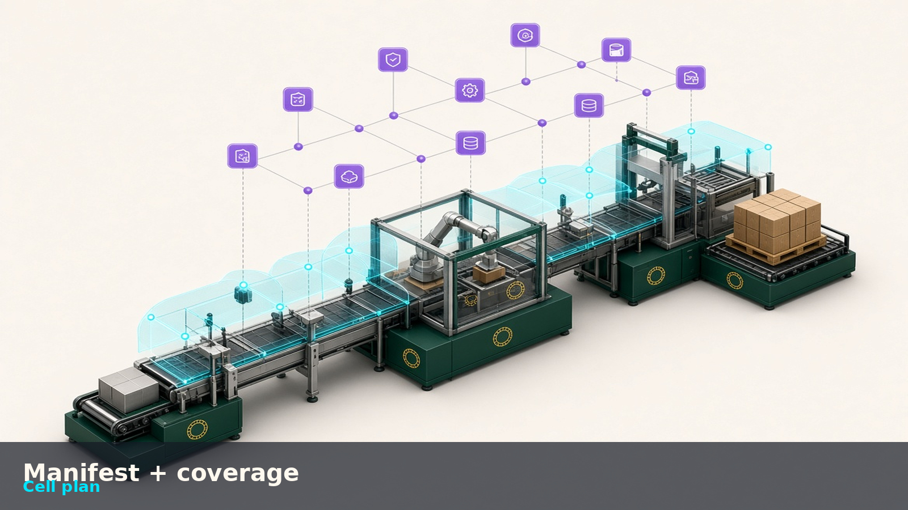

**Route:** `/applications`
**Alt:** Safety software manifest and coverage status for a packaging and palletising line.
**Caption:** Manifest lists safety-relevant software items; coverage states per function.
**CLI/API:** `POST /v1/machinery/manifest`

```tsx
<picture>
  <source srcSet="/images/visuals/packaging-safety-software-manifest-coverage.webp" type="image/webp" />
  
</picture>
```

## fleet-advisory-hash-matched-fanout

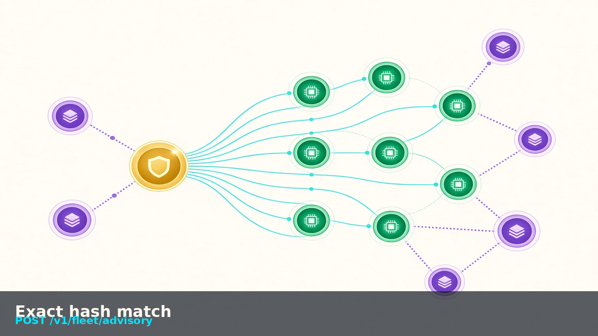

**Route:** `/applications`
**Alt:** Supplier advisory fanned out across enrolled machine serials matched by exact hash.
**Caption:** One advisory matched by SHA-256, never by version-range arithmetic.
**CLI/API:** `POST /v1/fleet/advisory`

```tsx
<picture>
  <source srcSet="/images/visuals/fleet-advisory-hash-matched-fanout.webp" type="image/webp" />
  
</picture>
```

## fleet-exact-hash-never-version-range

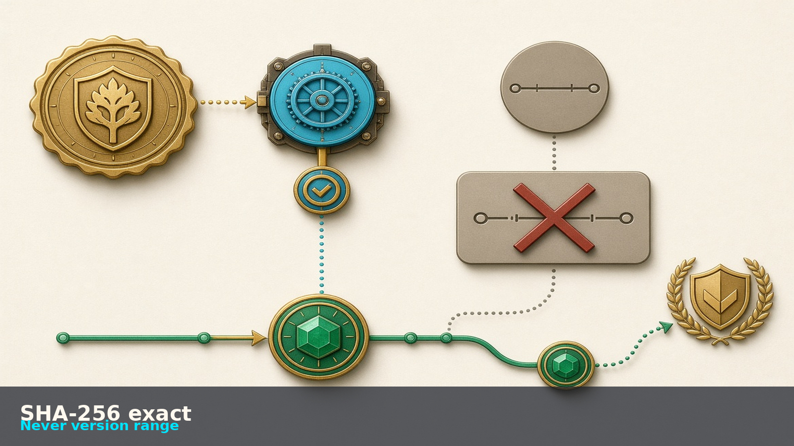

**Route:** `/applications`
**Alt:** Exact SHA-256 hash matching shown as the only accepted method; version-range arithmetic is rejected.
**Caption:** Deterministic by hash; version ranges are never flattened into a boolean.
**CLI/API:** `POST /v1/fleet/advisory`

```tsx
<picture>
  <source srcSet="/images/visuals/fleet-exact-hash-never-version-range.webp" type="image/webp" />
  
</picture>
```

## oem-article14-register-deadline-clocks

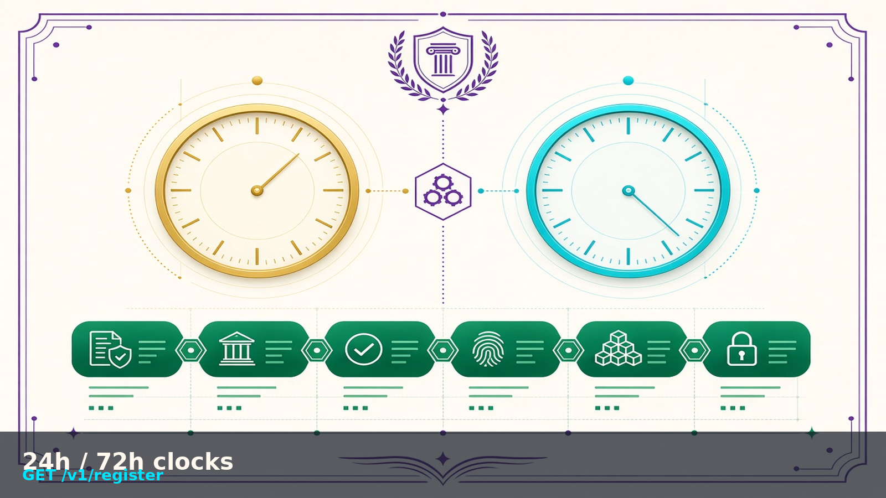

**Route:** `/applications`
**Alt:** OEM Article 14 register showing both 24-hour and 72-hour deadline clocks over a hash-chained ledger.
**Caption:** Both clocks computed correctly; hash-chained ledger with verifiable export.
**CLI/API:** `GET /v1/register`

```tsx
<picture>
  <source srcSet="/images/visuals/oem-article14-register-deadline-clocks.webp" type="image/webp" />
  
</picture>
```

## oem-register-verifiable-export-unmetered


**Route:** `/applications`
**Alt:** Verifiable export of the Article 14 register with cases marked as not metered.
**Caption:** Cases are not metered — no per-case cap or charge.
**CLI/API:** `GET /v1/cases`

```tsx
<picture>
  <source srcSet="/images/visuals/oem-register-verifiable-export-unmetered.webp" type="image/webp" />
  
</picture>
```

## insurer-unmetered-evidence-check


**Route:** `/applications`
**Alt:** unmetered evidence verification path for insurers and auditors; no account required.
**Caption:** The buyer or auditor is never the paying customer.
**CLI/API:** `POST /v1/machine/bundle/check`

```tsx
<picture>
  <source srcSet="/images/visuals/insurer-unmetered-evidence-check.webp" type="image/webp" />
  
</picture>
```

## insurer-declaration-bundle-attestation-verify


**Route:** `/applications`
**Alt:** Three free verification paths: Declaration check, bundle re-verification and attestation verify.
**Caption:** What can be established from the file alone, and what cannot.
**CLI/API:** `POST /v1/ledger/attest/verify`

```tsx
<picture>
  <source srcSet="/images/visuals/insurer-declaration-bundle-attestation-verify.webp" type="image/webp" />
  
</picture>
```

## applications-route-to-plan-gating-matrix

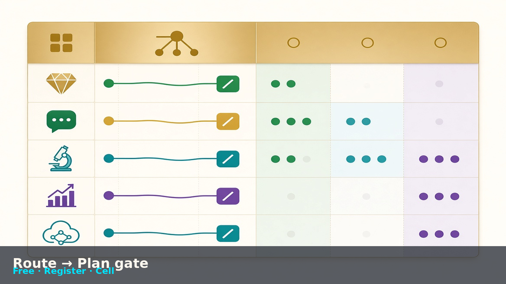

**Route:** `/applications`
**Alt:** Matrix mapping the five applications to their exact /v1 routes and the plan that gates each.
**Caption:** Every row is gated in code; if it is not gated, it is free.
**CLI/API:** `openapi.json`

```tsx
<picture>
  <source srcSet="/images/visuals/applications-route-to-plan-gating-matrix.webp" type="image/webp" />
  
</picture>
```

## applications-cli-local-to-optional-hosted

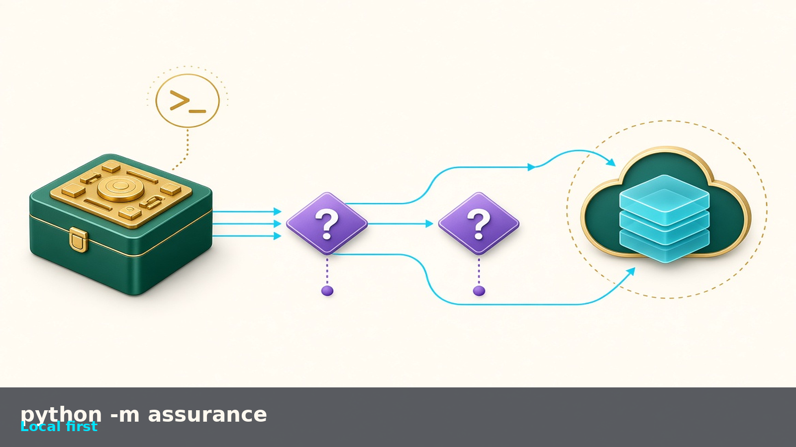

**Route:** `/applications`
**Alt:** Offline-first CLI that can later call a hosted deployment; kit and watch never leave the machine.
**Caption:** Same code the hosted API calls, runnable on your own machine first.
**CLI/API:** `python -m assurance`

```tsx
<picture>
  <source srcSet="/images/visuals/applications-cli-local-to-optional-hosted.webp" type="image/webp" />
  
</picture>
```

## applications-change-assurance-case-lifecycle

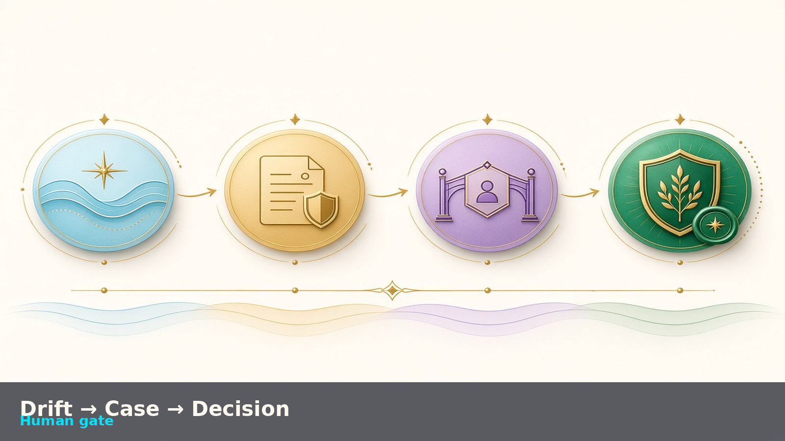

**Route:** `/applications`
**Alt:** Change-assurance case lifecycle from drift detection through human decision gate to close, reject or defer.
**Caption:** A named person owns the case; the product never decides.
**CLI/API:** `assurance change assess-drift`

```tsx
<picture>
  <source srcSet="/images/visuals/applications-change-assurance-case-lifecycle.webp" type="image/webp" />
  
</picture>
```

## applications-workspace-investigate-one-place


**Route:** `/applications`
**Alt:** Single workspace view of one enrolled machine showing configuration hash, evidence timeline and intervention history.
**Caption:** Configuration, evidence and intervention history in one place.
**API:** `POST /v1/check/fleet-machine`

```tsx
<picture>
  <source srcSet="/images/visuals/applications-workspace-investigate-one-place.webp" type="image/webp" />
  
</picture>
```


---

## Visual Architecture — Product Lifecycle

Target: [`/product/industrial-autonomous-assurance`](https://neuralbridge.io/product/industrial-autonomous-assurance)

## lifecycle-hero-end-to-end-assurance

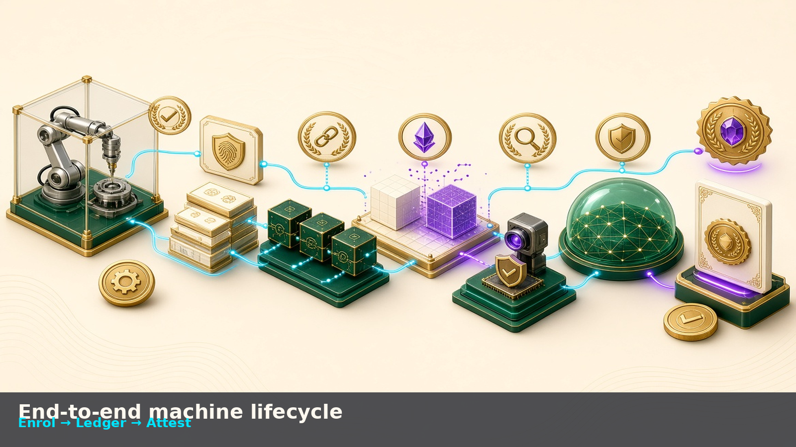

**Route:** `/product/industrial-autonomous-assurance`
**Alt:** End-to-end Industrial Autonomous Assurance lifecycle from enrolment through hash-chained ledger to passport and signed head.
**Caption:** Evidence that notices when the machine changed.
**CLI/API:** `POST /v1/machinery/enrol · assurance machinery passport · assurance attest sign`

```tsx
<picture>
  <source srcSet="/images/visuals/lifecycle-hero-end-to-end-assurance.webp" type="image/webp" />
  
</picture>
```

## lifecycle-enrolment-named-person-seals-manifest


**Route:** `/product/industrial-autonomous-assurance`
**Alt:** A named person enrols a machine, sealing a baseline configuration manifest and receiving a receipt with the configuration hash.
**Caption:** Enrolment seals the baseline; the receipt carries the configuration hash.
**CLI/API:** `POST /v1/machinery/enrol`

```tsx
<picture>
  <source srcSet="/images/visuals/lifecycle-enrolment-named-person-seals-manifest.webp" type="image/webp" />
  
</picture>
```

## lifecycle-manifest-anatomy-hashes-sources

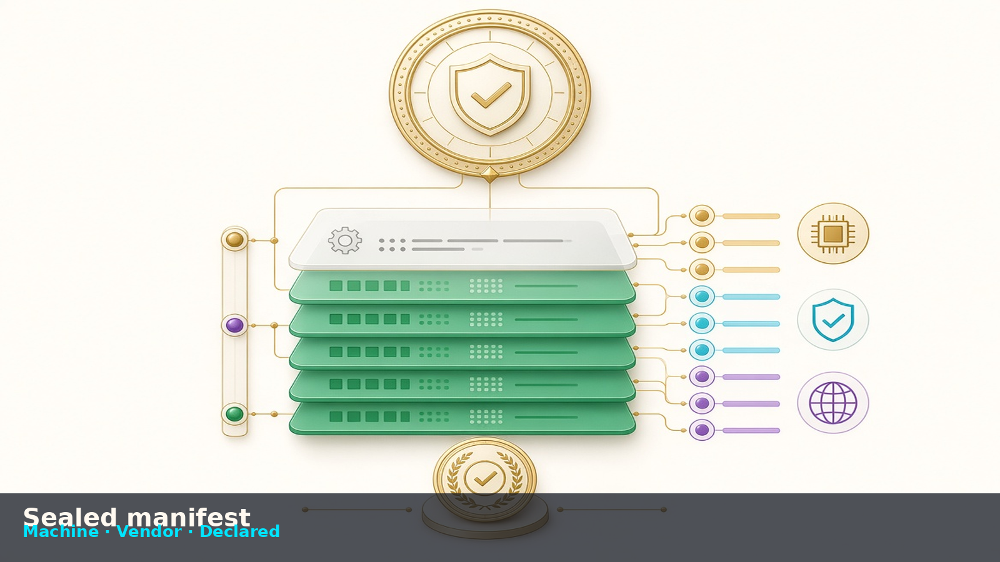

**Route:** `/product/industrial-autonomous-assurance`
**Alt:** Anatomy of a sealed safety software manifest showing items, functions and hash sources (machine, vendor or declared).
**Caption:** Each item is marked as read from the machine, supplied by the vendor, or declared.
**CLI/API:** `POST /v1/machinery/manifest`

```tsx
<picture>
  <source srcSet="/images/visuals/lifecycle-manifest-anatomy-hashes-sources.webp" type="image/webp" />
  
</picture>
```

## lifecycle-hash-chained-ledger-append

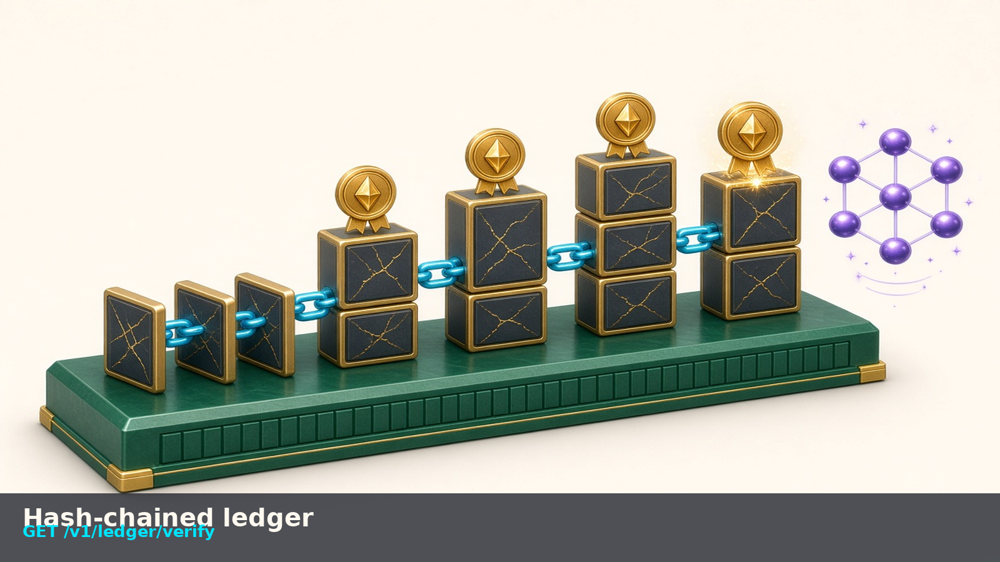

**Route:** `/product/industrial-autonomous-assurance`
**Alt:** Evidence records appended to a per-account hash-chained ledger that can be verified.
**Caption:** The ledger catches mid-chain edits; only an off-host counter-signature protects the head.
**CLI/API:** `GET /v1/ledger/verify`

```tsx
<picture>
  <source srcSet="/images/visuals/lifecycle-hash-chained-ledger-append.webp" type="image/webp" />
  
</picture>
```

## lifecycle-drift-detection-machinery-diff

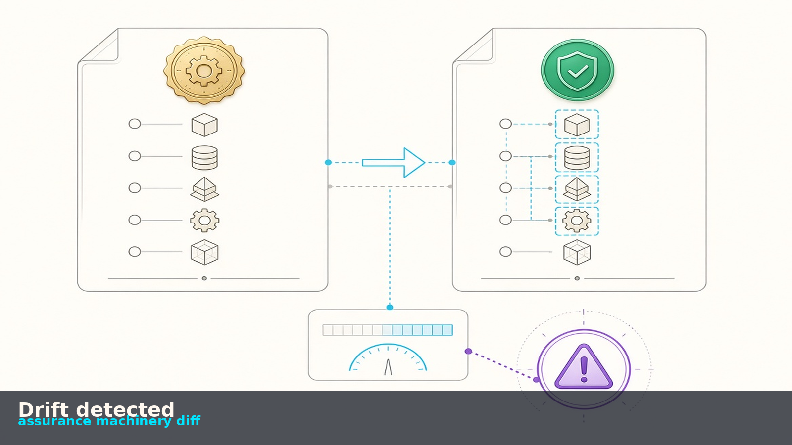

**Route:** `/product/industrial-autonomous-assurance`
**Alt:** Configuration drift detection comparing the sealed baseline manifest against the current machine state.
**Caption:** A differing manifest is a change; silent re-enrolment is refused.
**CLI/API:** `assurance machinery diff`

```tsx
<picture>
  <source srcSet="/images/visuals/lifecycle-drift-detection-machinery-diff.webp" type="image/webp" />
  
</picture>
```

## lifecycle-change-assurance-case-opened


**Route:** `/product/industrial-autonomous-assurance`
**Alt:** A change-assurance case opened from drift, intervention or supplier advisory, owned by a named person.
**Caption:** The product records the case; a named person decides to close, reject or defer.
**CLI/API:** `assurance change assess-drift`

```tsx
<picture>
  <source srcSet="/images/visuals/lifecycle-change-assurance-case-opened.webp" type="image/webp" />
  
</picture>
```

## lifecycle-verification-against-safety-envelope

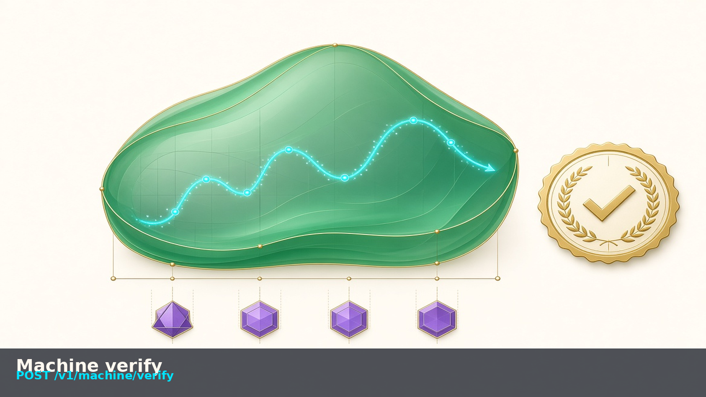

**Route:** `/product/industrial-autonomous-assurance`
**Alt:** Recorded machine run verified against the declared safety envelope with tiered results.
**Caption:** Unchecked is a valid outcome; the product does not invent a pass.
**CLI/API:** `POST /v1/machine/verify`

```tsx
<picture>
  <source srcSet="/images/visuals/lifecycle-verification-against-safety-envelope.webp" type="image/webp" />
  
</picture>
```

## lifecycle-coverage-states-current-stale-unchecked


**Route:** `/product/industrial-autonomous-assurance`
**Alt:** Coverage states per safety function: current, stale, failing, unchecked, incomplete or never done.
**Caption:** Coverage answers whether a prior verification still applies after a change.
**CLI/API:** `assurance machinery coverage`

```tsx
<picture>
  <source srcSet="/images/visuals/lifecycle-coverage-states-current-stale-unchecked.webp" type="image/webp" />
  
</picture>
```

## lifecycle-intervention-recording-dates-inapplicable

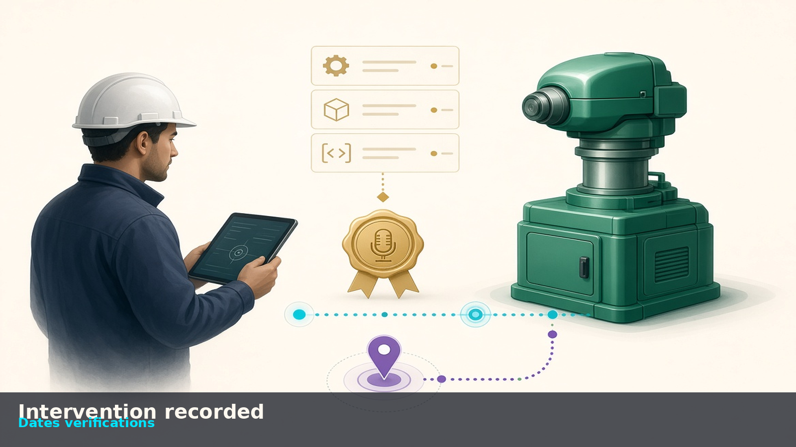

**Route:** `/product/industrial-autonomous-assurance`
**Alt:** Technician intervention recorded with the software items touched, dating when prior verifications become inapplicable.
**Caption:** The intervention names what was touched so coverage can be updated.
**CLI/API:** `assurance machinery record-change`

```tsx
<picture>
  <source srcSet="/images/visuals/lifecycle-intervention-recording-dates-inapplicable.webp" type="image/webp" />
  
</picture>
```

## lifecycle-passport-sealed-evidence-position


**Route:** `/product/industrial-autonomous-assurance`
**Alt:** Sealed machine passport that captures the current evidence position for external re-check.
**Caption:** A passport is re-checked with assurance machinery check or POST /v1/machinery/passport/check.
**CLI/API:** `assurance machinery passport`

```tsx
<picture>
  <source srcSet="/images/visuals/lifecycle-passport-sealed-evidence-position.webp" type="image/webp" />
  
</picture>
```

## lifecycle-signed-ledger-head-attestation


**Route:** `/product/industrial-autonomous-assurance`
**Alt:** Signed ledger head that attests the current head of the hash-chained evidence ledger.
**Caption:** The counter-signature protects the head; the chain itself detects mid-ledger edits.
**CLI/API:** `assurance attest sign`

```tsx
<picture>
  <source srcSet="/images/visuals/lifecycle-signed-ledger-head-attestation.webp" type="image/webp" />
  
</picture>
```

## lifecycle-external-verification-no-account


**Route:** `/product/industrial-autonomous-assurance`
**Alt:** External verification of a passport or evidence file that requires no account and stores nothing.
**Caption:** What can be established from the file alone is stated plainly; what cannot is also stated.
**CLI/API:** `POST /v1/machinery/passport/check`

```tsx
<picture>
  <source srcSet="/images/visuals/lifecycle-external-verification-no-account.webp" type="image/webp" />
  
</picture>
```

## lifecycle-artefacts-relationship-diagram

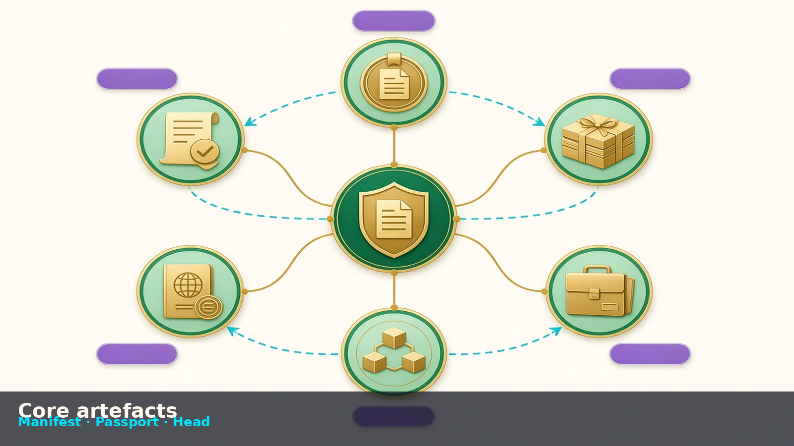

**Route:** `/product/industrial-autonomous-assurance`
**Alt:** Relationship diagram of core NeuralBridge artefacts: sealed manifest, receipt, verification bundle, passport, signed ledger head and case export.
**Caption:** Each artefact is re-checkable by anyone who holds the file.
**CLI/API:** `manifest · receipt · passport · attestation`

```tsx
<picture>
  <source srcSet="/images/visuals/lifecycle-artefacts-relationship-diagram.webp" type="image/webp" />
  
</picture>
```

## lifecycle-offline-kit-to-optional-hosted

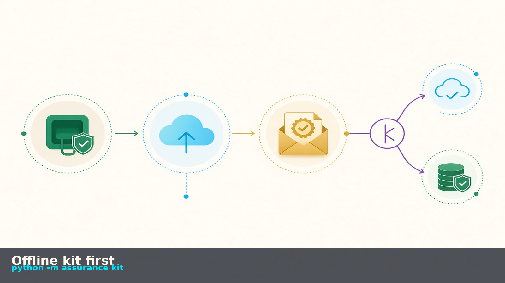

**Route:** `/product/industrial-autonomous-assurance`
**Alt:** Offline enrolment kit that runs locally with a process-level socket guard, with optional later push to a hosted ledger.
**Caption:** kit and watch never contact a deployment by design.
**CLI/API:** `python -m assurance kit`

```tsx
<picture>
  <source srcSet="/images/visuals/lifecycle-offline-kit-to-optional-hosted.webp" type="image/webp" />
  
</picture>
```

## lifecycle-full-operator-pipeline

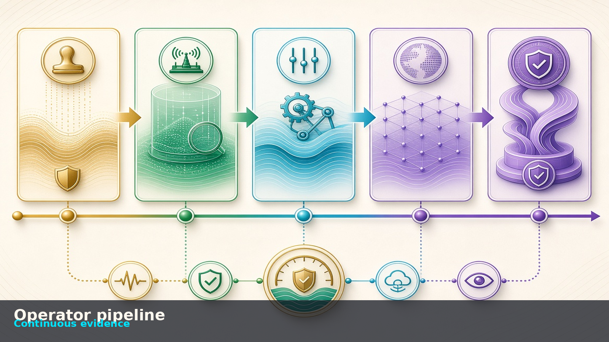

**Route:** `/product/industrial-autonomous-assurance`
**Alt:** Full operator pipeline from baseline seal through continuous monitoring, change cases and coverage updates to final attestation.
**Caption:** Continuous evidence that shows which checks still apply after a change.
**CLI/API:** `assurance watch · assurance change`

```tsx
<picture>
  <source srcSet="/images/visuals/lifecycle-full-operator-pipeline.webp" type="image/webp" />
  
</picture>
```


---

## NeuralBridge Role Pages Visual Architecture

Light premium visuals for the six solution / role pages.

### 01. manufacturer-declaration-of-conformity-evidence-gap
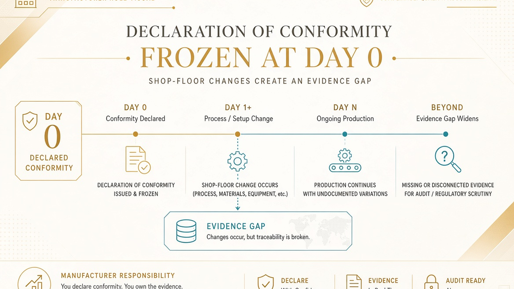

### 02. system-integrator-verifiable-evidence-chain
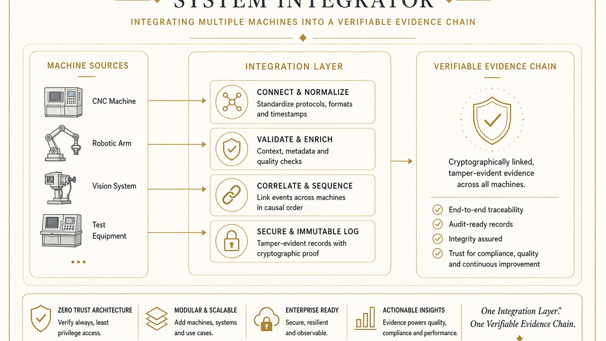

### 03. plant-operator-air-gapped-workstation
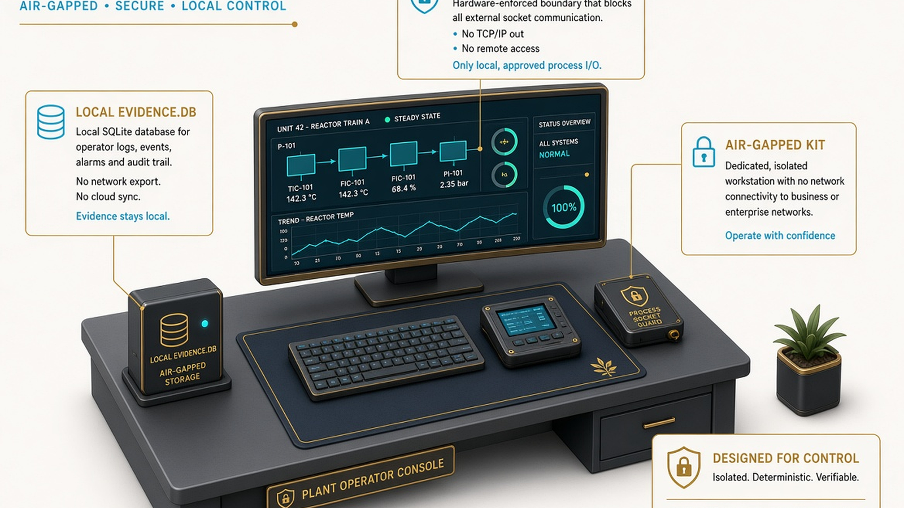

### 04. compliance-officer-cra-article-14-dual-clocks
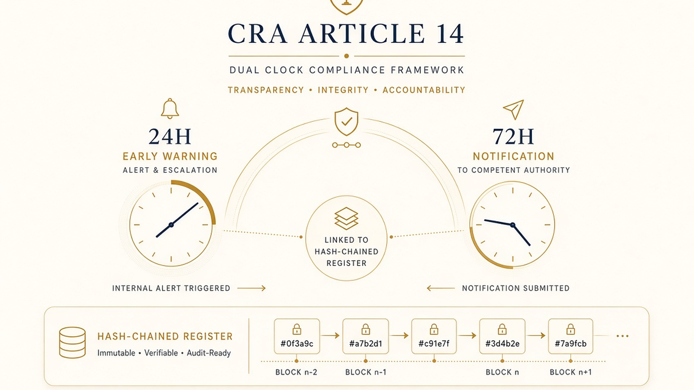

### 05. insurer-auditor-zero-account-verification
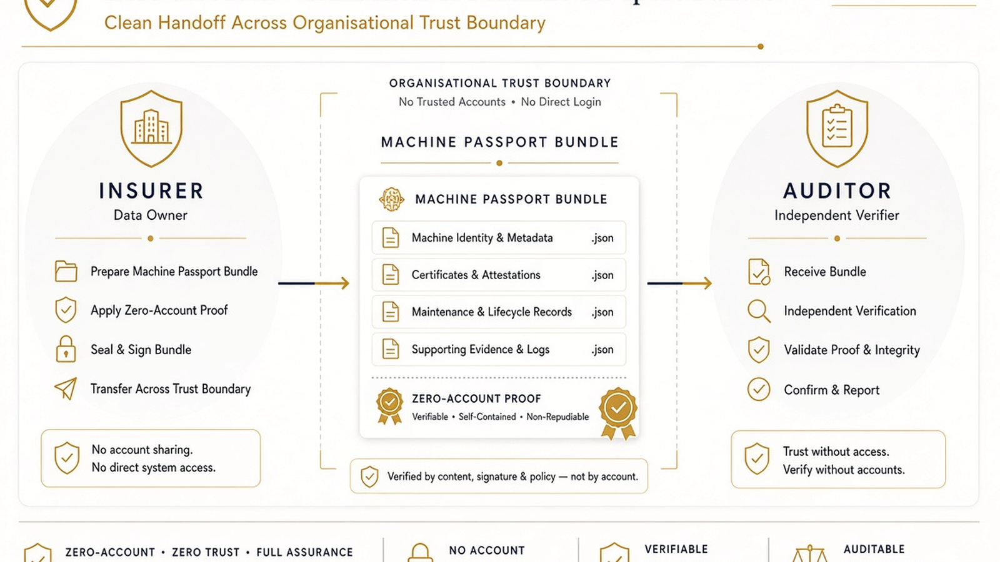

### 06. ai-ops-mcp-gateway-human-approval
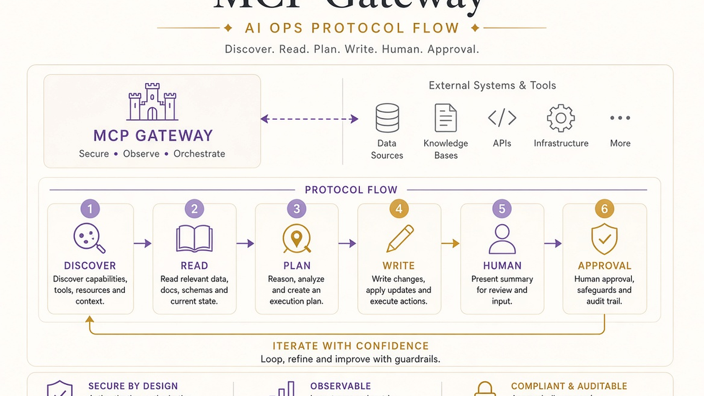

### 07. six-roles-overview
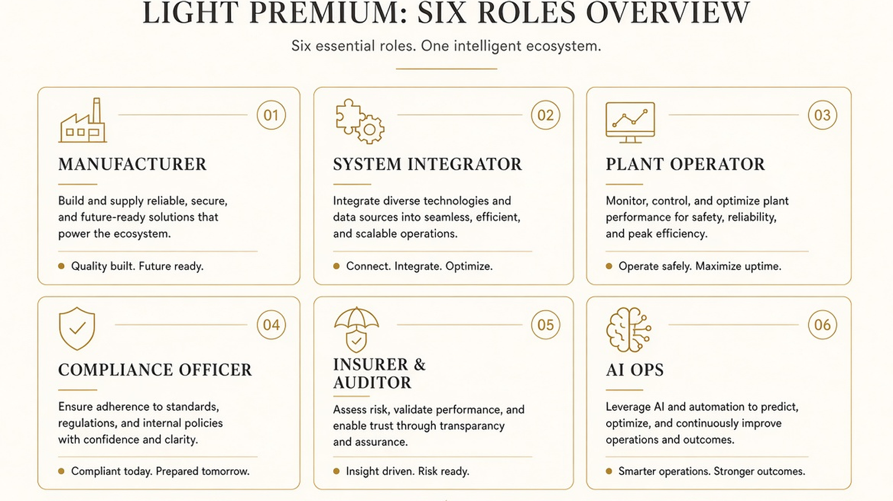

### 08. change-assurance-case-human-gate
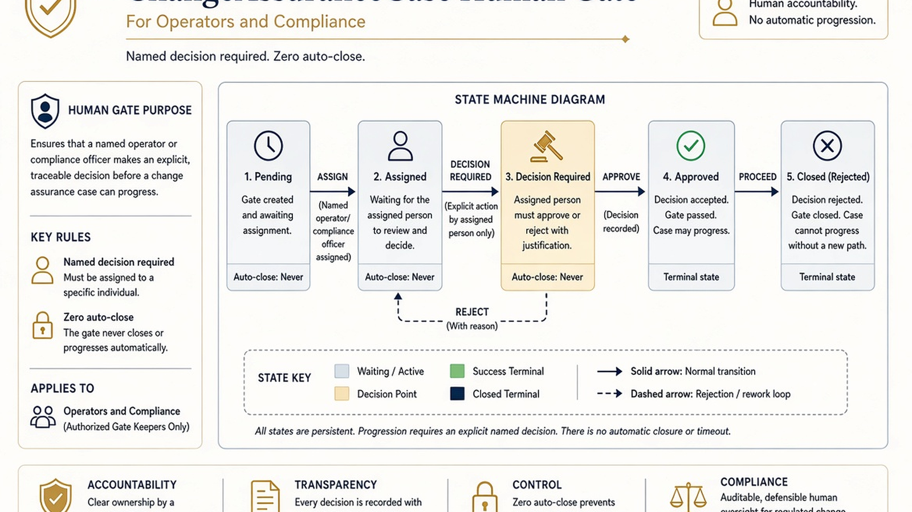

### 09. iso15066-coverage-for-operators-manufacturers
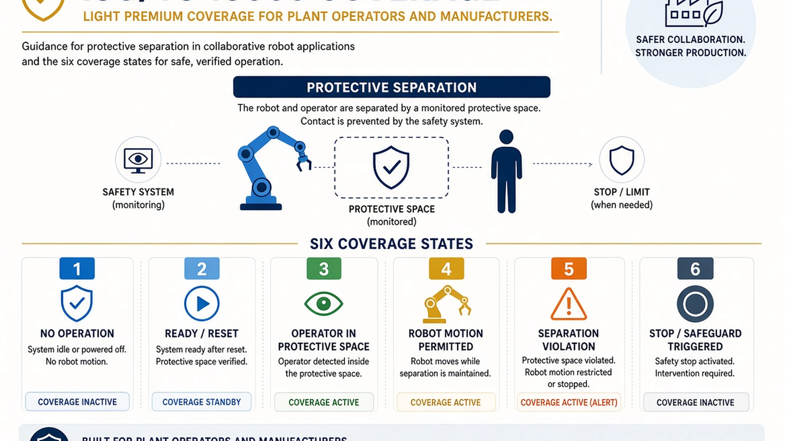

### 10. fleet-advisory-deterministic-fanout
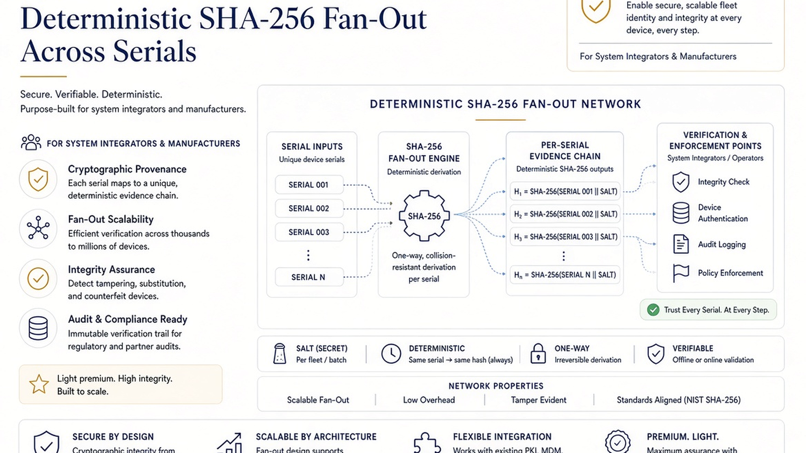

### 11. offline-enrolment-kit-for-plant
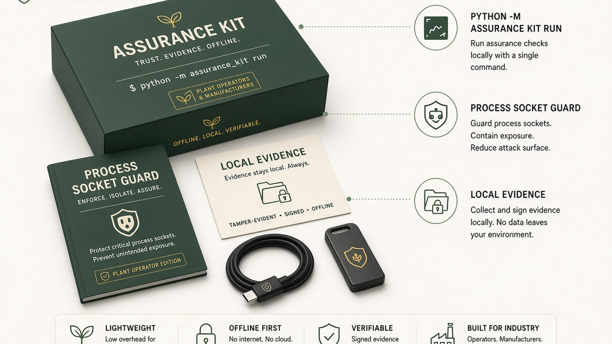

### 12. unmetered-verify-for-insurers-auditors


### 13. pricing-tiers-aligned-to-roles
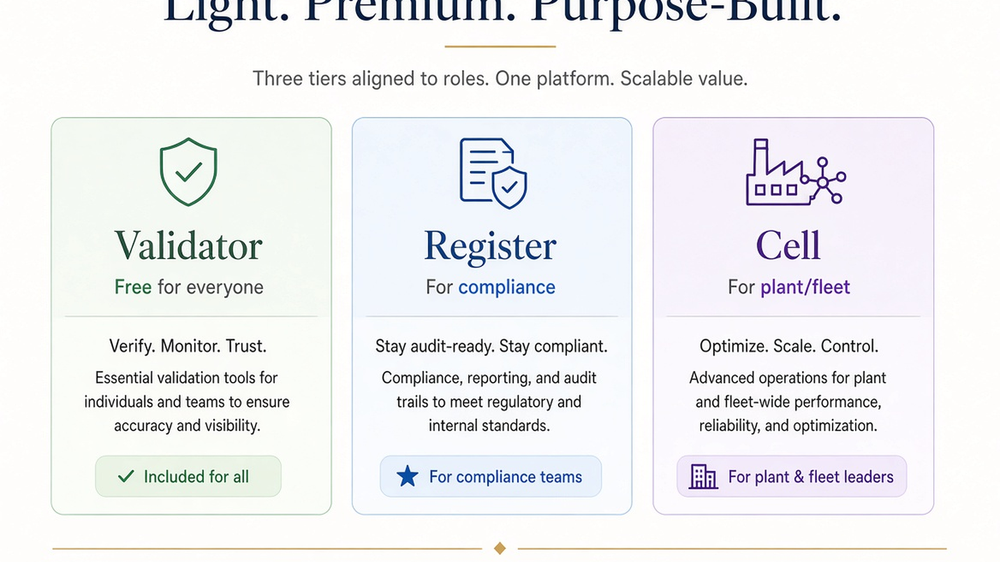

### 14. hash-chained-ledger-anatomy-all-roles
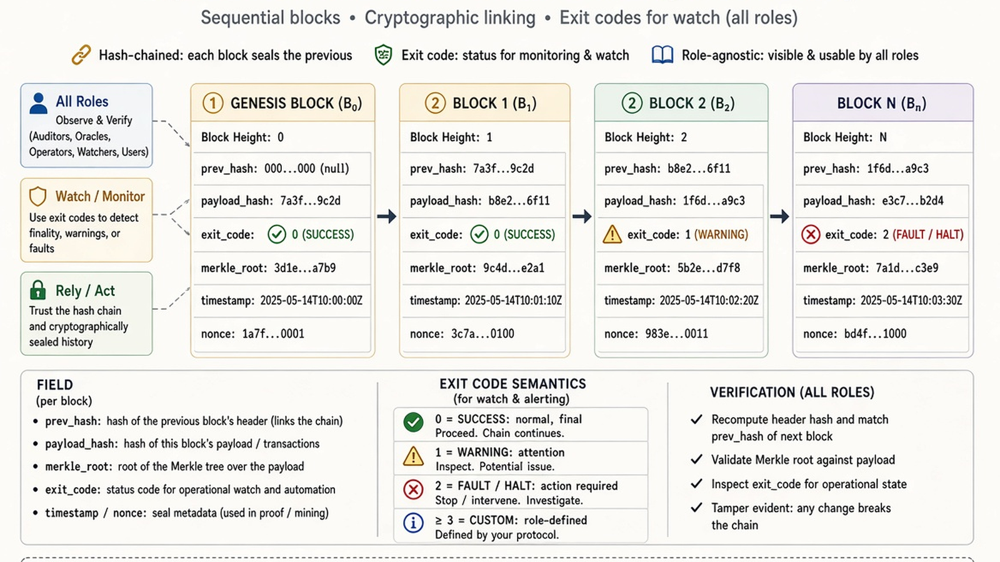

### 15. role-to-capability-mapping
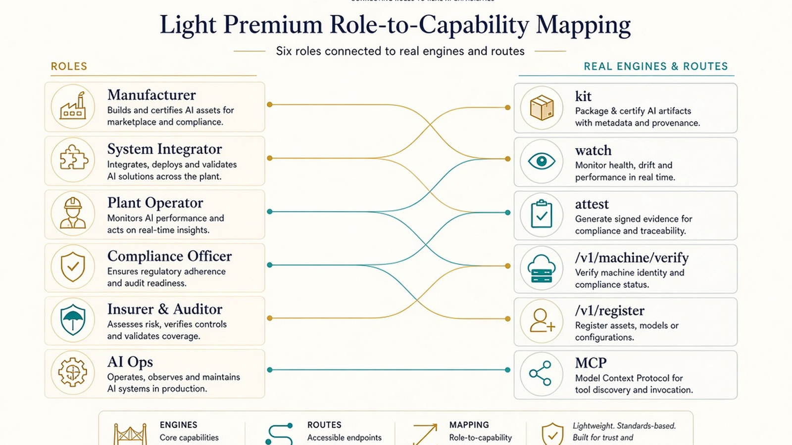
